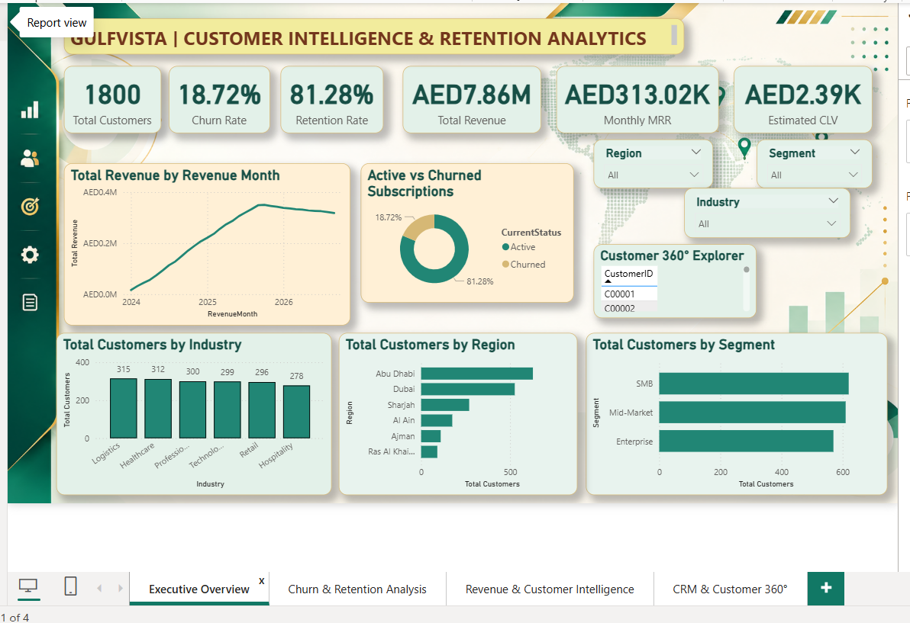
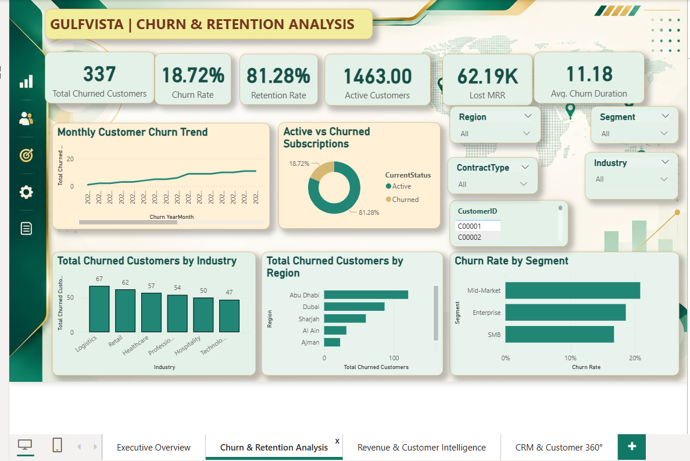
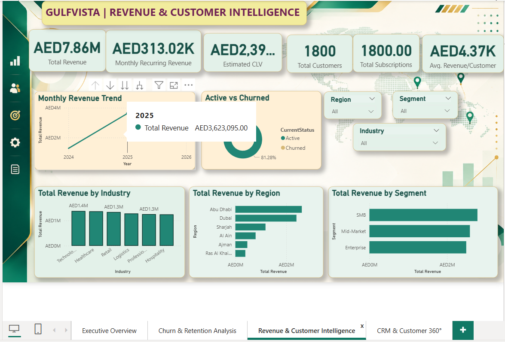
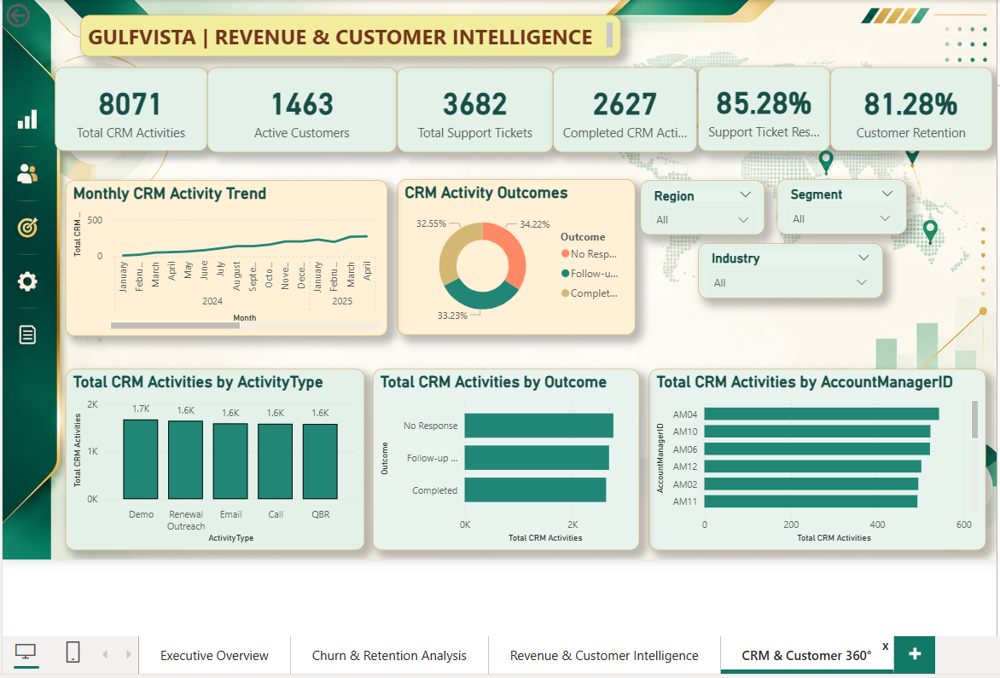

# GulfVista | Customer Churn & Retention Analytics

### End-to-End Business Intelligence & Business Analysis Portfolio Project

**Tech Stack:** SQL Server | Power BI | DAX | Jira | Confluence | Excel

## Project Overview

GulfVista Customer Churn & Retention Analytics is an end-to-end business intelligence solution designed to monitor customer churn, retention, subscription revenue, and CRM engagement.

The project combines business analysis, data validation, interactive dashboard development, and Agile project documentation to support data-driven customer retention decisions.

> **Disclaimer:** This is a portfolio project developed using synthetic customer and business data.

## Business Problem

Businesses need reliable visibility into customer attrition, recurring revenue, and retention campaign performance.

This project addresses the need for centralized KPI reporting, customer segmentation, and customer-level insights.

## Business Objectives

- Monitor active and churned customers.
- Analyze churn and retention rates.
- Track Monthly Recurring Revenue (MRR) and Average Revenue per User (ARPU).
- Identify customer segments with higher churn.
- Evaluate retention campaign performance.
- Monitor CRM activities and customer engagement.
- Enable customer-level drill-through analysis.

## Key Performance Indicators

| KPI | Business Purpose |
|---|---|
| Active Customers | Monitor current customer base |
| Churned Customers | Measure customer attrition |
| Churn Rate % | Evaluate customer loss |
| Retention Rate % | Measure customer retention |
| MRR | Track recurring subscription revenue |
| ARPU | Measure average revenue per user |
| Net New Customers | Monitor customer base growth |
| Campaign Lift | Evaluate retention campaign effectiveness |

## Power BI Dashboard

The solution includes four interactive reporting pages:

**Page 1 – Executive Overview**
- Customer and revenue KPI cards
- High-level churn and retention insights
- Interactive business filters

**Page 2 – Churn & Retention Analysis**
- Monthly churn trends
- Customer segmentation analysis
- Retention performance reporting

**Page 3 – Campaign Analysis**
- Retention campaign performance
- Campaign effectiveness metrics
- Customer engagement insights

**Page 4 – CRM & Customer 360°**
- Customer-level drill-through
- CRM activity and support analysis
- Customer engagement information

### Dashboard Features

- Interactive slicers and cross-filtering
- DAX-based KPI calculations
- Multi-page navigation
- Customer-level drill-through
- Back navigation and filter reset
- SQL-to-Power BI KPI reconciliation

## Data Model

The analytical solution uses customer, subscription, revenue, retention campaign, CRM activity, and date datasets.

Key tables include:

- DimCustomer
- DimDate
- FactSubscription
- FactMonthlyRevenue
- FactRetentionCampaign
- FactCRMActivity

## SQL Implementation

SQL Server was used for:

- Dataset imports and validation
- Row-count reconciliation
- Data quality checks
- Customer and subscription analysis
- KPI validation against Power BI calculations

## Business Analysis Deliverables

The project includes:

- Business Requirements Document (BRD)
- Functional Requirements Document (FRD)
- Requirements Traceability Matrix (RTM)
- User Acceptance Testing (UAT) Report
- Jira Agile Sprint 1 tracking
- Confluence project documentation

## UAT & Quality Assurance

Eight UAT work items were documented in Jira, covering data imports, KPI accuracy, slicer interactions, monthly churn, customer drill-through, CRM reporting, filter reset, and dashboard formatting.

Core dashboard validations were completed. Dedicated retention campaign UAT coverage remains pending confirmation.

## Tools & Technologies

| Tool | Application |
|---|---|
| SQL Server | Data import, querying, validation |
| Power BI | Interactive dashboard development |
| DAX | KPI calculations |
| Excel | Data preparation and analysis |
| Jira | Agile work item and sprint tracking |
| Confluence | Requirements and UAT documentation |
| GitHub | Portfolio documentation and version control |

## Project Outcome

Developed an integrated BI and BA portfolio solution demonstrating requirements analysis, analytical data modeling, KPI development, interactive reporting, SQL validation, Agile delivery, and UAT documentation.

## Author

**Suruthi Venkatesan**

Business Analyst | Business Intelligence Analyst | Power BI PL-300 Certified

*Portfolio project | October 2026*

---

## Power BI Dashboard Screenshots

### Page 1 – Executive Overview

### Page 2 – Churn & Retention Analysis

### Page 3 – Campaign Analysis

### Page 4 – Customer 360

